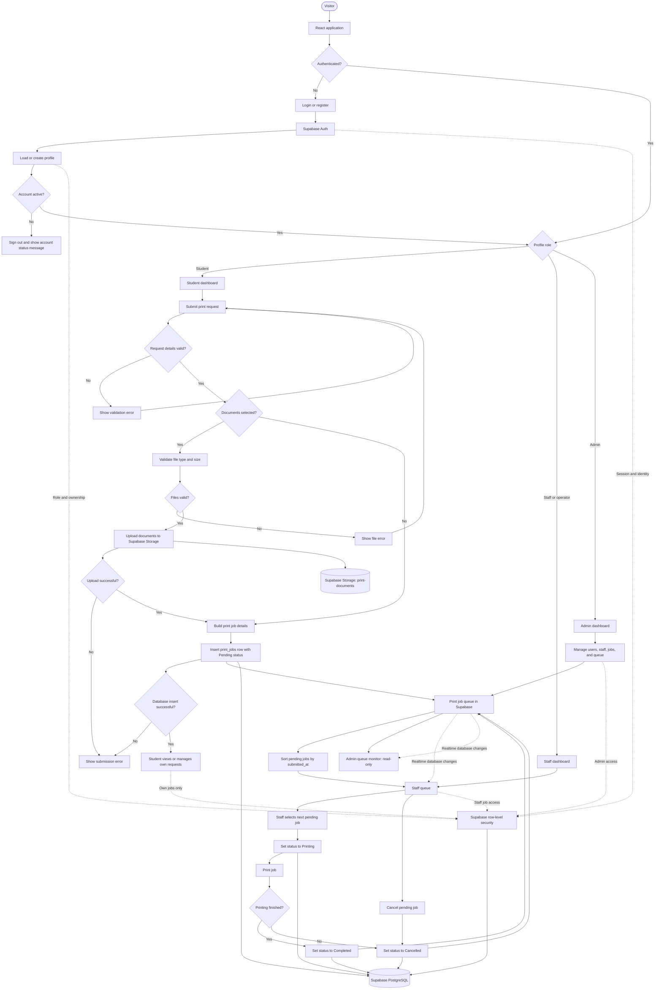

# Printer Job Scheduler — System Flow Chart

## Key behavior

- Unauthenticated visitors are sent to login. After authentication, the profile role determines the dashboard; inactive or deleted non-admin accounts are signed out.
- Students submit print details and may attach documents. Files are validated and uploaded before a `Pending` job is inserted.
- Pending jobs are ordered by submission time (first-come, first-served). Staff can move jobs from `Pending` to `Printing` or `Cancelled`, then from `Printing` to `Completed` or `Cancelled`.
- Staff and admin queue screens refresh from Supabase Realtime changes. Admin queue monitoring is read-only; admin tools also support user, staff, and job management.
- Supabase Auth, PostgreSQL row-level security, and Storage provide identity, role/ownership-based data access, and document storage.
